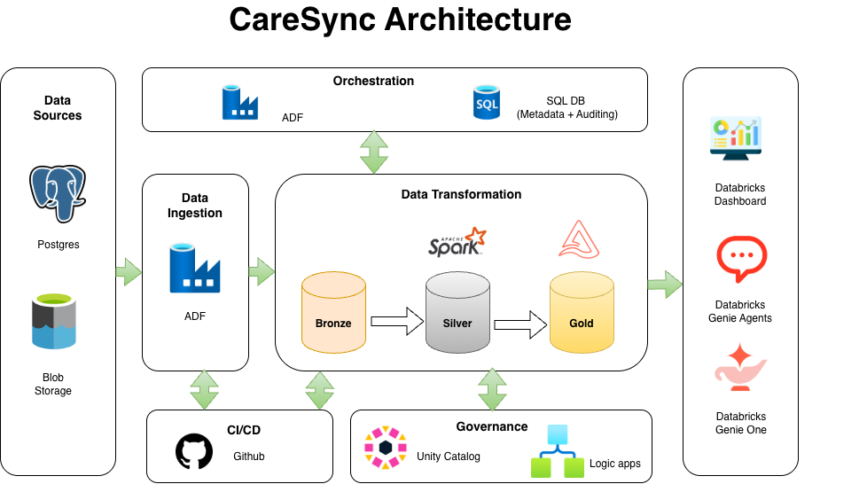
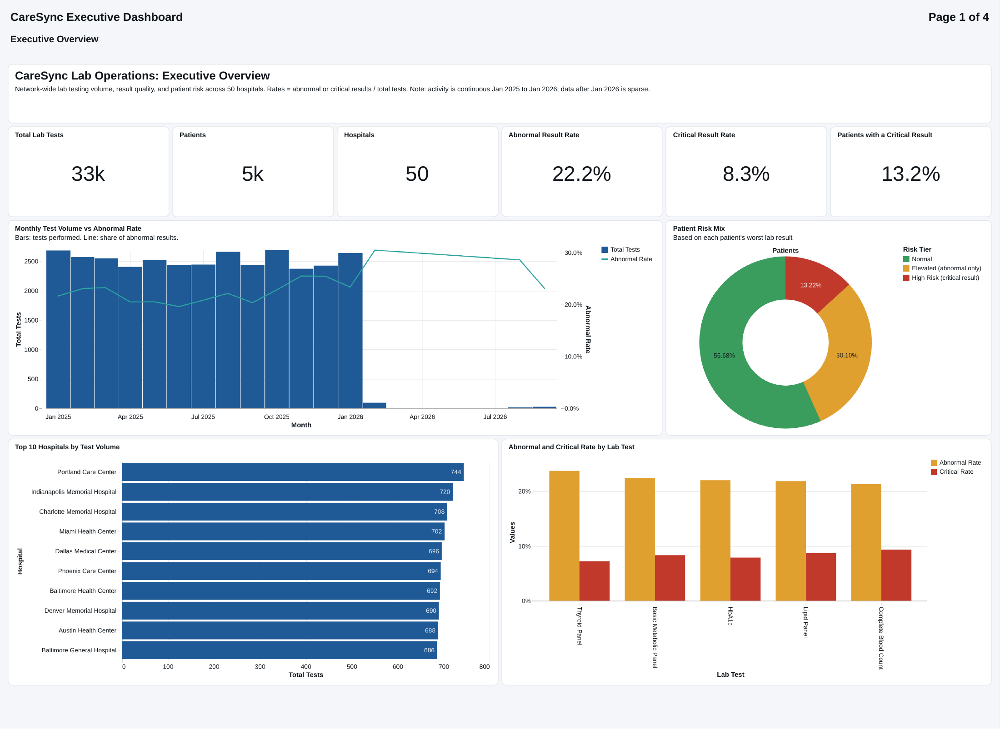
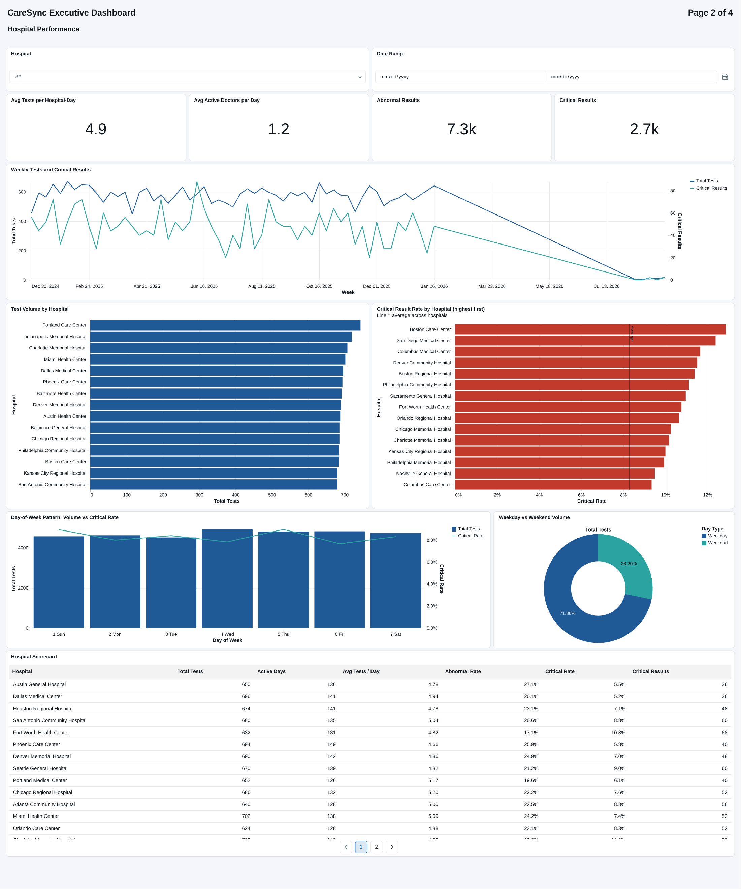
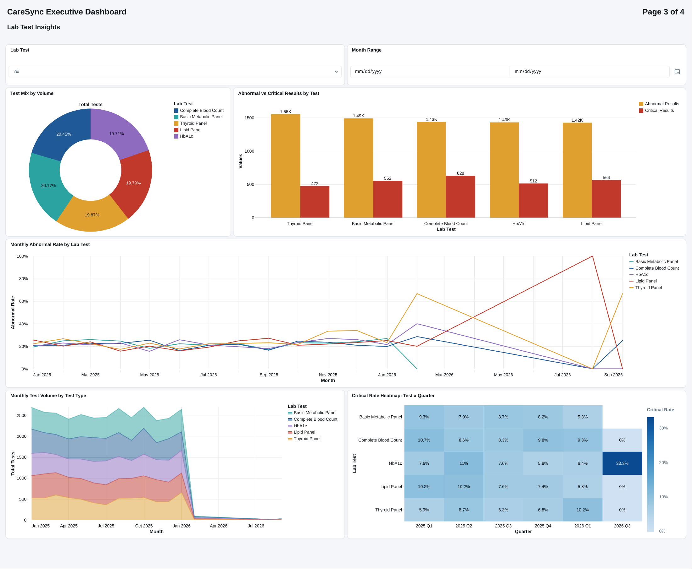
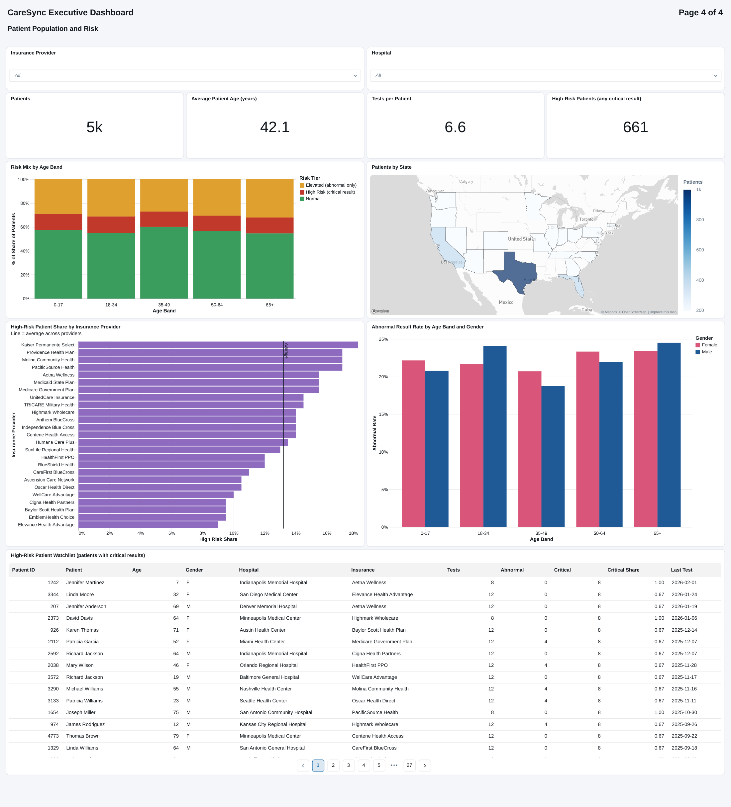

# CareSync – End-to-End Healthcare Data Engineering Platform on Azure

CareSync is an end-to-end, **metadata-driven** data platform for a (fictional) network of 50 hospitals.
It ingests hospital data from **PostgreSQL** and partner **CSV files**, processes it through a **medallion architecture** (bronze → silver → gold) in **Azure Databricks** under **Unity Catalog**, and serves the results through a **4-page Databricks AI/BI dashboard** and **Genie** for natural-language questions.

Everything is orchestrated by **Azure Data Factory**, tracked in an **Azure SQL control database** (config, watermarks, audit log), alerted on through **Azure Logic Apps**, and version-controlled in **GitHub**.

> **Repositories**
> | Repo | Contents |
> |---|---|
> | [`caresync-data-platform`](https://github.com/surekhag28/caresync-data-platform) (this repo) | Documentation, architecture, STTM, dashboards, SQL scripts, sample data |
> | [`adf-data-engineering-caresync`](https://github.com/surekhag28/adf-data-engineering-caresync) | ADF pipelines, datasets, linked services, trigger |
> | [`adb-caresync`](https://github.com/surekhag28/adb-caresync) | Databricks notebooks (landing → bronze → silver → gold) |

---

## Table of contents
1. [Business goal](#1-business-goal)
2. [Architecture](#2-architecture)
3. [Tech stack](#3-tech-stack)
4. [Data sources](#4-data-sources)
5. [Metadata-driven framework](#5-metadata-driven-framework)
6. [Orchestration (ADF)](#6-orchestration-adf)
7. [Data processing (Databricks)](#7-data-processing-databricks)
8. [Gold data model](#8-gold-data-model)
9. [Dashboards](#9-dashboards)
10. [Monitoring, auditing and alerts](#10-monitoring-auditing-and-alerts)
11. [Governance and security](#11-governance-and-security)
12. [CI/CD and version control](#12-cicd-and-version-control)
13. [Repository structure](#13-repository-structure)
14. [How to run](#14-how-to-run)
15. [Key learnings](#15-key-learnings)
16. [Future improvements](#16-future-improvements)

---

## 1. Business goal

Give hospital executives, operations managers and care teams **one trusted view of lab activity and patient risk**, so they can:

- spot patients with **critical or abnormal lab results** early and prioritise follow-up
- compare **hospital performance**: test volume, staffing activity and critical-result rates
- track **lab test trends** month by month and quarter by quarter
- understand the **patient population** by hospital, insurer, age and location

---

## 2. Architecture



**End-to-end flow**

```
SOURCES                 INGESTION (ADF)                          LANDING (ADLS Gen2)
Neon PostgreSQL ──┐                                              landing/
 hospitals,       │  pl_master (daily 06:00 AEST)                 ├── neon_postgres/<table>/<landing_timestamp>/  (Parquet)
 doctors,         ├─► reads ctrl.table_config (Azure SQL)  ─────► └── adls_csv/<table>/<landing_timestamp>/       (CSV)
 patients         │   FULL / APPEND / MERGE + watermarks
ADLS CSV files ───┘
 lab_results,
 insurance_providers

TRANSFORMATION (Azure Databricks + Unity Catalog: adb_caresync)
landing volume ─► BRONZE (raw, append-only, audit columns)
               ─► SILVER (typed, deduplicated; FULL overwrite / APPEND / MERGE)
               ─► GOLD   (patient_360, hospital_daily_summary, lab_test_trends)

CONSUMPTION                         OPERATIONS
Databricks AI/BI dashboard (4 pages) ctrl.audit_log → Logic App → email run summary
Databricks Genie (natural-language)  GitHub (ADF + Databricks code), Unity Catalog governance
```

---

## 3. Tech stack

| Area | Technology |
|---|---|
| Sources | Neon **PostgreSQL**, **CSV** files in ADLS Gen2 |
| Orchestration & ingestion | **Azure Data Factory** (Lookup, ForEach, Switch, If Condition, Execute Pipeline, Copy, Script, Web, Fail) |
| Control & audit metadata | **Azure SQL Database** (`ctrl` schema) |
| Storage | **ADLS Gen2** – `landing` container (raw files) and `medallion` container (Delta tables) |
| Processing | **Azure Databricks** – PySpark, Spark SQL, **Delta Lake** |
| Governance | **Unity Catalog** – storage credential (Access Connector), external locations, volumes, managed tables |
| Secrets | **Azure Key Vault** (ADF linked service) |
| Alerting | **Azure Logic Apps** (HTTP trigger → HTML email) |
| Analytics | **Databricks AI/BI Dashboards**, **Databricks Genie** |
| Version control / CI/CD | **GitHub** (ADF Git integration, Databricks Git folders) |

---

## 4. Data sources

| Source system | Object | Load type | Watermark | Merge key | Description |
|---|---|---|---|---|---|
| Neon PostgreSQL | `hospitals` | FULL | – | – | Hospital master data (~50 hospitals) |
| Neon PostgreSQL | `doctors` | FULL | – | – | Doctor roster (~500 doctors) |
| Neon PostgreSQL | `patients` | MERGE | `updated_at` | `patient_id` | Patient registrations & demographics (~5,000) |
| ADLS CSV (partner feed) | `lab_results` | APPEND | `reported_at` | – | Lab test results (~33k tests) |
| ADLS CSV (partner feed) | `insurance_providers` | FULL | – | – | Insurance provider reference data |

Sample CSV files for an **initial** and an **incremental** load are in [`data/`](data/).

> All data in this project is **synthetic** (generated for learning purposes). No real patient information is used.

---

## 5. Metadata-driven framework

All pipelines are driven by three control tables in **Azure SQL Database** ([`sql/metadata/create_control_table.sql`](sql/metadata/create_control_table.sql)):

| Table | Purpose |
|---|---|
| `ctrl.table_config` | One row per source object or gold table: source system, path, load type, watermark column, merge keys, **stage** (`SOURCE_TO_SILVER` / `SILVER_TO_GOLD`), `is_active` |
| `ctrl.watermark` | Last processed watermark per incremental table (starts at `1900-01-01` so the first run loads full history) |
| `ctrl.audit_log` | One row per table, per run, per stage: `IN_PROGRESS` / `SUCCESS` / `FAILED`, records written, start and end time |

Adding a new table or gold output means **adding a config row**, not changing pipeline code.

### Load types

| Load type | Bronze | Silver |
|---|---|---|
| **FULL** | Append (with `landing_timestamp`) | Overwrite |
| **APPEND** | Append | Append |
| **MERGE** | Append | Delta `MERGE` on `merge_keys` (latest row per key); creates the table on the first run |

### Incremental loads
- **PostgreSQL tables:** `WHERE <watermark_column> > <last watermark>`
- **CSV files:** filtered by file *last modified* time against the stored watermark
- The watermark is updated **only after a successful** silver load.

---

## 6. Orchestration (ADF)

| Pipeline | What it does |
|---|---|
| `pl_master` | Entry point. Runs **Postgres** and **CSV** ingestion in parallel → Silver to Gold → Send email. Scheduled daily at **06:00 AEST** (`TGR_CARESYNC`). |
| `pl_from_source_to_silver_main` | Reads active `SOURCE_TO_SILVER` rows for a source system and loops over them (ForEach). Writes `IN_PROGRESS` / `FAILED` to the audit log. |
| `pl_from_source_to_silver_inner` | Per table: read config → read watermark (incremental only) → **Switch** on source type → Copy to landing → `Landing_to_Bronze` → `Bronze_to_Silver` → update audit log and watermark. |
| `pl_from_silver_to_gold` | Loops over `SILVER_TO_GOLD` rows and runs `Gold/NB_<gold_table_name>` for each, with audit logging. |
| `pl_send_email` | Reads the run's audit records, builds subject/header/footer and calls the **Logic App**. |

```
pl_master
 ├── Source to Silver (postgres) ─┐
 ├── Source to Silver (csv) ──────┼──► Silver to Gold ──► Send email
 │      └── pl_from_source_to_silver_main
 │             └── ForEach table → pl_from_source_to_silver_inner
 │                    Copy → Landing_to_Bronze → Bronze_to_Silver → audit + watermark
```

Global parameters: `env` (e.g. `DEV`), `email_recipient`, `logic_apps_url`.

---

## 7. Data processing (Databricks)

**Unity Catalog layout**

```
adb_caresync (catalog)
 ├── landing  → landing-volume           (external volume on the landing container)
 ├── bronze   → raw Delta tables          (managed location: medallion/bronze)
 ├── silver   → cleaned Delta tables      (managed location: medallion/silver) + calendar
 └── gold     → reporting tables          (managed location: medallion/gold)
```

| Notebook | Purpose |
|---|---|
| `Landing_to_Bronze` | Reads Parquet/CSV from the landing volume, adds `landing_timestamp` and `insert_timestamp`, appends to bronze |
| `Bronze_to_Silver` | Reads the current batch from bronze, validates merge keys, adds audit columns, writes with FULL / APPEND / MERGE; returns the record count to ADF |
| `Create Calendar Table` | Builds `silver.calendar` (one row per day, 1940–2030) for date attributes |
| `Gold/NB_patient_360`, `Gold/NB_hospital_daily_summary`, `Gold/NB_lab_test_trends` | Build the gold tables (full rebuild) |

---

## 8. Gold data model

The silver-to-gold logic is specified in a **Source-to-Target Mapping** workbook: [`docs/gold_sttm/sttm_silver_to_gold.xlsx`](docs/gold_sttm/sttm_silver_to_gold.xlsx). All gold tables are rebuilt each run (`CREATE OR REPLACE TABLE ... AS SELECT`) and use **LEFT JOINs** from the driving table so no rows are lost.

| Gold table | Grain | Key measures | Answers |
|---|---|---|---|
| `patient_360` | One row per patient | Demographics, age, hospital, insurer, total / abnormal / critical tests, last test date | *Which patients are at risk and need follow-up?* |
| `hospital_daily_summary` | One row per hospital per day | Tests, unique patients, active doctors, abnormal / critical rates, day-over-day change (`LAG`) | *How is each hospital performing?* |
| `lab_test_trends` | One row per test type per month | Tests, abnormal / critical rates, month-over-month change (`LAG`) | *Are results for a test getting better or worse?* |

---

## 9. Dashboards

A 4-page **Databricks AI/BI dashboard** (“CareSync Executive Dashboard”) is built on the gold tables.
GitHub cannot display PDFs inside a README, so each page is shown as a PNG snapshot of its PDF export. Click a snapshot to open it full size, or click **PDF** to open the original export.

<table>
  <tr>
    <td align="center" width="50%"><b>Page 1 – Executive Overview</b> · <a href="docs/dashboards/01_executive_overview.pdf">PDF</a><br>
      <a href="docs/dashboards/01_executive_overview.png"></a></td>
    <td align="center" width="50%"><b>Page 2 – Hospital Performance</b> · <a href="docs/dashboards/02_hospital_performance.pdf">PDF</a><br>
      <a href="docs/dashboards/02_hospital_performance.png"></a></td>
  </tr>
  <tr>
    <td align="center" width="50%"><b>Page 3 – Lab Test Insights</b> · <a href="docs/dashboards/03_lab_test_insights.pdf">PDF</a><br>
      <a href="docs/dashboards/03_lab_test_insights.png"></a></td>
    <td align="center" width="50%"><b>Page 4 – Patient Population and Risk</b> · <a href="docs/dashboards/04_patient_population_and_risk.pdf">PDF</a><br>
      <a href="docs/dashboards/04_patient_population_and_risk.png"></a></td>
  </tr>
</table>

| Page | What it shows | Who uses it |
|---|---|---|
| **1. Executive Overview** | Network KPIs: **33k lab tests, 5k patients, 50 hospitals, 22.2% abnormal rate, 8.3% critical rate, 13.2% of patients with a critical result**. Monthly test volume vs abnormal rate, patient risk mix (Normal / Elevated / High Risk), top 10 hospitals by volume, abnormal and critical rate by lab test. | Executives |
| **2. Hospital Performance** | Hospital and date filters. Avg tests per hospital-day, avg active doctors per day, abnormal and critical results. Weekly tests vs critical results, volume and critical rate by hospital (vs network average), day-of-week and weekday vs weekend patterns, **hospital scorecard**. | Hospital and operations managers |
| **3. Lab Test Insights** | Lab test and month filters. Test mix, abnormal vs critical results by test, monthly abnormal rate by test, monthly volume by test type, **critical-rate heatmap** (test × quarter). | Lab and clinical quality teams |
| **4. Patient Population and Risk** | Insurer and hospital filters. KPIs: **5k patients, average age 42.1, 6.6 tests per patient, 661 high-risk patients**. Risk mix by age band, patients by state (map), high-risk share by insurance provider (vs average), abnormal rate by age band and gender, and a **high-risk patient watchlist** for follow-up. | Care teams and insurance / finance teams |

### Genie
A **Databricks Genie** space on the gold tables lets business users ask questions in plain English, e.g. *“Which 5 hospitals had the highest critical rate last quarter?”*

> Note: test activity is continuous from Jan 2025 to Jan 2026; data after Jan 2026 is sparse, which shows as drops in the trend charts.

---

## 10. Monitoring, auditing and alerts

- Every table, run and stage is logged to `ctrl.audit_log` (`IN_PROGRESS` → `SUCCESS` / `FAILED`, records written, start and end time).
- A failed table marks its audit row `FAILED`, and a **Fail** activity marks the pipeline failed, while other tables continue.
- At the end of each run, `pl_send_email` calls a **Logic App** (HTTP trigger) that sends an HTML email:
  - Subject: `<ENV> | SUCCESS / FAILED | CARESYNC MASTER RUN`
  - Body: header, a **status table** of every table processed in the run, and a footer.
- Notebooks return record counts to ADF with `dbutils.notebook.exit()`.

---

## 11. Governance and security

- **Unity Catalog** governs all data: one catalog (`adb_caresync`), schemas per layer, managed tables and a governed landing volume.
- Storage is accessed through a **storage credential** backed by an **Access Connector for Azure Databricks** (managed identity with *Storage Blob Data Contributor*) and **external locations**. No storage keys in code.
- Separate containers for raw files (`landing`) and governed tables (`medallion`).
- Secrets for ADF linked services are stored in **Azure Key Vault**.

---

## 12. CI/CD and version control

- **ADF** is connected to GitHub with Git integration: work happens in **feature branches** → pull request → `main`; publishing generates ARM templates in the `adf_publish` branch for deployment to other environments.
- **Databricks** notebooks are developed in **Git folders** connected to the `adb-caresync` repo, using feature branches and pull requests.
- The `env` global parameter separates environments (e.g. `DEV`, `PROD`).

---

## 13. Repository structure

```
caresync-data-platform/
├── README.md
├── data/
│   ├── initial_load/          # first CSV drop (insurance_providers, lab_results)
│   └── incremental_load/      # second CSV drop for incremental testing
├── docs/
│   ├── caresync_architecture.png
│   ├── dashboards/            # 4 dashboard pages: PDF exports + PNG snapshots
│   │   ├── 01_executive_overview.pdf / .png
│   │   ├── 02_hospital_performance.pdf / .png
│   │   ├── 03_lab_test_insights.pdf / .png
│   │   └── 04_patient_population_and_risk.pdf / .png
│   └── gold_sttm/
│       └── sttm_silver_to_gold.xlsx
└── sql/
    ├── metadata/              # Azure SQL control database
    │   ├── create_control_table.sql
    │   ├── drop_control_table.sql
    │   └── insert_sample_audit_log.sql
    └── source/                # Neon PostgreSQL source system
        ├── 01_create_source_tables.sql
        ├── 02_run_incremental_load.sql
        └── 02_run_incremental_load_2.sql
```

---

## 14. How to run

1. **Source database (Neon PostgreSQL):** run `sql/source/01_create_source_tables.sql` to create and seed `hospitals`, `doctors` and `patients`.
2. **Control database (Azure SQL):** run `sql/metadata/create_control_table.sql` to create `ctrl.table_config`, `ctrl.watermark` and `ctrl.audit_log` and seed the config (use `drop_control_table.sql` to reset).
3. **Azure resources:** resource group, ADLS Gen2 with `landing` and `medallion` containers, Databricks workspace (Premium), Access Connector with *Storage Blob Data Contributor*, Key Vault, Azure SQL Database, Logic App.
4. **Unity Catalog:** storage credential → external locations (`landing`, `medallion`) → catalog `adb_caresync` → schemas `landing`, `bronze`, `silver`, `gold` (with managed locations) → `landing-volume`. Run `Create Calendar Table`.
5. **Source files:** upload `data/initial_load/*.csv` to the source container.
6. **ADF:** connect the factory to [`adf-data-engineering-caresync`](https://github.com/surekhag28/adf-data-engineering-caresync), update linked services and global parameters (`env`, `email_recipient`, `logic_apps_url`).
7. **Run** `pl_master` (or enable `TGR_CARESYNC`) and check the email summary and `ctrl.audit_log`.
8. **Test incremental loads:** run `sql/source/02_run_incremental_load*.sql` and upload `data/incremental_load/*.csv`, then run `pl_master` again.

---

## 15. Key learnings

- Designing a **metadata-driven** ADF framework with config, watermark and audit tables
- **Unity Catalog** setup: storage credentials, external locations, managed vs external storage, volumes
- **Delta Lake** `MERGE`, schema enforcement and evolution, time travel
- Handling real pipeline issues: path mismatches, null parameters, broken Delta logs, schema mismatches
- Turning silver data into **business-ready gold tables** from an STTM, and building dashboards on them
- End-to-end **alerting** with Logic Apps

## 16. Future improvements

- CI/CD automation with **GitHub Actions** and **Databricks Asset Bundles**
- Infrastructure as code with **Terraform**
- **Data quality checks** (e.g. unique keys, null checks) with quarantine tables
- Streaming ingestion with **Auto Loader** / **Event Hubs**
- Row-level security and PII masking on `patient_360`